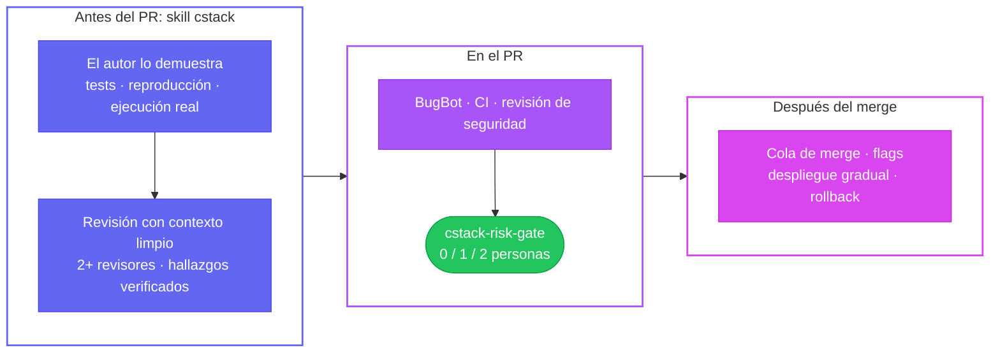

<div align="center">

<picture>
  <source media="(prefers-color-scheme: dark)" srcset="docs/assets/banner-dark.svg">
  
</picture>

<br/>

[](https://github.com/yulmucoffee/cstack/actions/workflows/ci.yml)
[](LICENSE)


[English](README.md) · [한국어](README.ko.md) · [日本語](README.ja.md) · [简体中文](README.zh-CN.md) · **Español**

### Di "revisa este PR". Recibe una revisión con pruebas, no una avalancha de detalles menores.

**La forma de trabajar del equipo de Claude Code, con la filosofía de agentes pstack de poteto integrada.**<br/>
[Cómo hace code review el equipo de Claude Code](https://claude.dev/blog/solving-code-review-at-anthropic/): revisión por capas, aprobación humana según el riesgo, revisiones que convergen.<br/>
[pstack](https://github.com/cursor/plugins/tree/main/pstack) de [@poteto](https://github.com/poteto): diffs pequeños, pruebas en el entorno real, revisión adversarial con varios modelos.

[Inicio rápido](#inicio-rápido) · [Cómo usarlo](#cómo-usarlo) · [Cómo funciona](#cómo-funciona) · [Activar el control obligatorio](#activar-el-control-obligatorio) · [Para agentes](FOR_AGENTS.md)

</div>

> [!TIP]
> **Deja que tu agente de IA lo configure.** Pega esto en Claude Code, Codex o Cursor:
>
> ```text
> Configura cstack siguiendo https://github.com/yulmucoffee/cstack/blob/main/FOR_AGENTS.md
> ```
>
> El agente te pregunta si lo quieres solo para ti o para un repositorio. Después lo instala, revisa el resultado y te indica los pocos ajustes que solo tú puedes cambiar.

## Por qué cstack

Los agentes de IA ya escriben pull requests más rápido de lo que las personas pueden leerlos. El equipo de Claude Code [contó cómo lo resuelve](https://claude.dev/blog/solving-code-review-at-anthropic/). Pasó la mayor parte de la lectura a las máquinas, organizó las comprobaciones en capas y ajustó la aprobación humana al riesgo. El número de PR que llegaron a merge se duplicó con creces, y la proporción que hubo que revertir bajó más de un 40 %. [pstack](https://github.com/cursor/plugins/tree/main/pstack) de poteto explica cómo debe trabajar un agente para que su resultado merezca confianza.

cstack reúne ambas cosas en archivos que se instalan en un minuto.

<table>
<tr>
<td width="33%" valign="top">

### 🔍 Revisiones con pruebas

Cada "revisa esto" lanza dos revisores con el mismo prompt en modelos distintos. Después, un verificador nuevo comprueba cada hallazgo, y ejecuta el código cuando es seguro hacerlo. Solo recibes los hallazgos que superan esa comprobación, cada uno con su `file:line` y su evidencia.

</td>
<td width="33%" valign="top">

### 🧭 Funciona donde ya trabajas

Una sola skill para **Claude Code**, **Codex** y **Cursor**, más reglas de revisión para **Cursor BugBot**. Sin servidor y sin cuenta. Archivos normales en tu repositorio o en tu carpeta personal.

</td>
<td width="33%" valign="top">

### 🛡️ Aprobación según el riesgo

Una comprobación opcional de GitHub fija cuántas aprobaciones humanas necesita un PR: 0 para documentación, 1 para código, 2 para CI, autenticación, facturación, migraciones o autores externos.

</td>
</tr>
</table>

## Inicio rápido

Necesitas Python 3.10 o posterior y `git`. Los comandos funcionan en bash, zsh y PowerShell. En Windows, usa `py -3` en lugar de `python3`.

**Opción A: deja que lo haga tu agente.** Usa el prompt del recuadro de arriba. El agente sigue [FOR_AGENTS.md](FOR_AGENTS.md).

**Opción B: solo para mí, en todos los repositorios**

```bash
git clone --depth 1 https://github.com/yulmucoffee/cstack.git "$HOME/.cstack/src"
```

```bash
python3 "$HOME/.cstack/src/scripts/install.py" --global
```

Eso es todo. Abre una nueva sesión del agente y di "revisa mis cambios".

**Opción C: para el repositorio de mi equipo**

```bash
python3 "$HOME/.cstack/src/scripts/install.py" --target /path/to/repo
```

```bash
python3 "$HOME/.cstack/src/scripts/doctor.py" --target /path/to/repo
```

El doctor muestra qué está configurado y qué falta. Haz commit del resultado y luego consulta [Activar el control obligatorio](#activar-el-control-obligatorio).

<details>
<summary><b>¿Prefieres el plugin de Claude Code?</b></summary>

```text
/plugin marketplace add yulmucoffee/cstack
/plugin install cstack@cstack
```

En ese caso, la skill es `/cstack:cstack`. Un plugin no puede editar `CLAUDE.md`, así que pega el texto de [`templates/routing.md`](templates/routing.md) en `~/.claude/CLAUDE.md`. Así, todas las peticiones de revisión llegan a cstack.

</details>

## Cómo usarlo

Solo pídelo, con las palabras que quieras y en cualquier idioma. No necesitas nombrar la skill.

| Tú dices | Qué pasa |
| --- | --- |
| "Revisa este PR", "PR 42 리뷰해줘" | **review**: lee el PR y las reglas del repositorio que aplican, lanza dos revisores en modelos distintos y hace que un verificador nuevo confirme cada hallazgo. Te informa a ti. Solo lectura. Publica en el PR solo si se lo pides. |
| "Revisa mis cambios antes de hacer commit" | **review** de tu trabajo sin commit. |
| "El botón de exportar envía el formulario dos veces. Arréglalo." | **fix**: primero lo reproduce, corrige la causa raíz y muestra el antes y el después. |
| "Pon el PR 42 en verde", "Atiende los comentarios de BugBot" | **babysit**: conflictos, luego hilos, luego CI. Se detiene cuando el PR está listo para merge y nunca hace merge. |
| "Haz ship de los PR 41 a 43" | **ship**: solo cuando lo pides de forma explícita. Hace merge de los PR verificados empezando por la base del stack. |

Los comandos integrados como `/code-review`, `/security-review` y `/review` de Codex siguen funcionando. Si pides uno junto con cstack, se ejecuta como una pasada extra.

<details>
<summary><b>Cómo es un informe de revisión</b></summary>

```text
MODE: review | VERDICT: BLOCKED | REF: 6c41928
FINDINGS: 2 actionable
  [ACT ON][high]   cart.py:4  coupon > subtotal -> negative total -> total([20], {amount: 50}) == -30 (CONFIRMED by verifier)
  [ACT ON][medium] cart.py:4  negative coupon amount raises the price -> {amount: -30} -> 50 (CONFIRMED by verifier)
DECLINED: percent coupons treated as flat: the change only adds flat coupons
PROOF: python3 repro.py -> both reproduced on the branch, absent on main
SAFETY FACT: callers without a coupon are unaffected: PROVED (ran both branches)
REVIEWERS: A=Anthropic/Sonnet, B=Anthropic/Opus, both found #1 and #2 | independence: same-vendor
NEXT: clamp at zero, validate the amount, add the four missing tests
```

Los hallazgos vienen de una ejecución real en un repositorio de demostración. Esa ejecución es anterior al paso del verificador nuevo, así que las etiquetas `CONFIRMED` muestran el formato actual y no el resultado de aquella ejecución. Un informe empieza con el veredicto y el número de hallazgos, da el resultado del verificador para cada hallazgo, enumera lo que se descartó y por qué, y nombra los modelos que realmente revisaron. El informe real sale en el idioma en que lo pediste.

</details>

<details>
<summary><b>Cómo escribir una buena petición</b></summary>

Según los consejos de pstack sobre prompts:
- **Incluye:** el objetivo, una comprobación que pueda pasar o fallar, la prueba que quieres ver, lo que ya sabes y los límites reales ("primero reprodúcelo", "no hagas merge").
- **Deja fuera:** cómo hacerlo, una lista de pasos y tu suposición sobre la causa.
- **Corrige el rumbo en una línea:** "Te pedí que lo reprodujeras, todavía no que lo arreglaras."

</details>

## Cómo funciona

La revisión ocurre por capas. Ninguna capa tiene que detectarlo todo.



**Lo que la skill exige**

- **Pruebas, no afirmaciones.** Cada afirmación lleva su evidencia o se marca como `measured`, `inferred` o `guess`.
- **Dos revisores para todo salvo documentación.** Mismo prompt, modelos distintos. Un diff corto no es una excepción. Si cambian más de unas 800 líneas, cada revisor recorre el diff en varias pasadas, una parte cada vez.
- **Un verificador nuevo para cada hallazgo.** Solo los hallazgos `CONFIRMED` de severidad media o superior pueden bloquear, y un hallazgo de severidad alta sin probar deja el veredicto en `INCONCLUSIVE`, nunca en `PASS`. El agente principal no puede anular un hallazgo confirmado de corrección o de seguridad, y enumera todo lo que descartó.
- **El código no confiable no se ejecuta.** Los tests y builds de forks o de autores sin permiso de escritura solo se ejecutan con tu aprobación, y nunca con tus secretos. Si no, la revisión sigue el código sin ejecutarlo.
- **Reglas donde aplican.** `CLAUDE.md`, `AGENTS.md` y `REVIEW.md` se leen desde la rama base en cada directorio que toca el PR, y un hallazgo de convenciones cita su regla.
- **Un hecho de seguridad.** Busca el único hecho del que depende que el cambio sea seguro y lo demuestra ejecutando código, o indica `UNPROVEN`.
- **Las revisiones convergen.** Como máximo tres rondas sobre un mismo problema. Tras la primera pasada, solo vuelve a revisar el diff nuevo, nombra la clase de bug y nunca repite un hallazgo.
- **Babysit no es ship.** Poner un PR en verde nunca hace merge.

**Niveles de riesgo que fija el gate**

| Cambio | Autor de confianza | Cualquier otro |
| --- | :---: | :---: |
| Solo documentación (`.md`, `.mdx`, `.rst`, `.adoc`, imágenes en `docs/`) | 0 | 2 |
| Código, configuración, dependencias, instrucciones para agentes (`CLAUDE.md`, `AGENTS.md`, `REVIEW.md`, skills) | 1 | 2 |
| CI, CODEOWNERS, `.cstack/`, configuración de BugBot, hooks de agentes, auth, security, billing, payments, migrations, secrets, Terraform, lockfiles | 2 | 2 |

En todos los niveles, las aprobaciones solo cuentan si cumplen todo esto:
- Son sobre el commit actual.
- Vienen de propietarios, miembros o colaboradores del repositorio, nunca del autor del PR.
- No hay ninguna solicitud de cambios pendiente y todos los hilos de revisión están resueltos.
- El check del revisor de IA pasó (`success`, no `neutral`) y vino de su GitHub App real.

Ante cualquier fallo, el gate bloquea: un error de la API, un PR en borrador o una política rota impiden el merge. Las reglas completas están en [docs/design.md](docs/design.md).

## Activar el control obligatorio

La skill funciona justo después de instalarla. El gate de merge no bloquea nada hasta que GitHub lo exige. Ejecuta el doctor cuando quieras para ver en qué punto estás.

- [ ] **Haz merge primero del PR de instalación.** Su check `cstack-risk-gate` falla, porque la rama base todavía no tiene el gate. Un mantenedor hace merge de este PR con una revisión normal.
- [ ] **Indica los mantenedores de confianza** en `.cstack/policy.json`, dentro de `trusted_authors`. Hasta entonces, cada PR necesita dos aprobaciones.
- [ ] **Activa BugBot** para el repositorio en el panel de Cursor. Si usas otro revisor de IA, cambia `required_check_names` y `required_check_apps`.
- [ ] **Haz obligatorios los checks** con un ruleset. Incluye tus checks de CI en [`templates/ruleset.json`](templates/ruleset.json) y luego ejecuta el comando de abajo, o configura lo mismo en Settings › Rules.
- [ ] **Protege el gate.** Define CODEOWNERS para `.github/workflows/`, `.cstack/` y `.cursor/`, y exige la revisión de los code owners. Sin esto, un PR podría editar el propio workflow del gate.

```bash
gh api -X POST repos/OWNER/REPO/rulesets --input "$HOME/.cstack/src/templates/ruleset.json"
```

> [!IMPORTANT]
> cstack nunca hace merge por su cuenta. Que el gate pase significa "permitido", no "adelante".

## Referencia

<details>
<summary><b>Instalador: qué va dónde</b></summary>

| Ruta en tu repositorio | Tipo | Al reinstalar |
| --- | --- | --- |
| `.claude/skills/cstack/`, `.agents/skills/cstack/` | gestionado | se actualiza si no lo has editado |
| `CLAUDE.md`, `AGENTS.md` | bloque marcado | solo se inserta o reemplaza el bloque de enrutamiento de revisiones |
| `.cursor/BUGBOT.md` | bloque marcado | solo se reemplaza el bloque de cstack |
| `.cstack/gate.py`, `.github/workflows/cstack-gate.yml` | gestionado | se actualiza si no lo has editado |
| `.cstack/policy.json`, `.cursor/config/bugbot.yaml`, `REVIEW.md`, `.github/pull_request_template.md` | semilla | se crea una vez y nunca se sobrescribe |
| `.cstack/manifest.json` | registro | hashes de los archivos gestionados |

**Opciones**

| Flag | Qué hace |
| --- | --- |
| `--global` | Instalación personal. Escribe la skill en `~/.claude/skills` y `~/.agents/skills`, y el bloque de enrutamiento en `~/.claude/CLAUDE.md` y `~/.codex/AGENTS.md` para las herramientas que tengas. |
| `--no-gate` | Omite el workflow del gate, `gate.py` y `policy.json`. |
| `--no-routing` | No toca `CLAUDE.md` ni `AGENTS.md`. |
| `--hosts claude,codex,cursor` | Elige dónde se instala la skill. El valor por defecto `claude,codex` también cubre Cursor. |
| `--force` | Sobrescribe los archivos gestionados que hayas editado. Los archivos semilla nunca se sobrescriben. |
| `--dry-run` | Muestra lo que cambiaría. |

Un `CLAUDE.md` que solo importa `@AGENTS.md` no se toca. Si ya existe una plantilla de PR en cualquiera de los lugares donde GitHub la busca, se respeta.

</details>

<details>
<summary><b>Claves de <code>policy.json</code></b></summary>

| Clave | Valor por defecto | Significado |
| --- | --- | --- |
| `trusted_authors` | `[]` | Logins de GitHub que reciben los niveles más ligeros. No distingue mayúsculas de minúsculas. |
| `additional_high_risk_patterns` | `infra/**`, `**/deploy/**`, `**/production/**` | Rutas extra que siempre necesitan dos personas. |
| `required_check_names` | `["Cursor Bugbot"]` | Checks que deben terminar en `success`. |
| `required_check_apps` | `{"Cursor Bugbot": "cursor"}` | Solo cuenta un check publicado por esta GitHub App. |
| `approver_associations` | `OWNER`, `MEMBER`, `COLLABORATOR` | De quién cuentan las aprobaciones. |
| `require_resolved_review_threads` | `true` | Bloquea si hay hilos sin resolver. |
| `check_wait_seconds` | `600` | Cuánto esperar a los checks obligatorios que siguen en ejecución. |

</details>

<details>
<summary><b>Actualización</b></summary>

```bash
git -C "$HOME/.cstack/src" pull --ff-only
```

```bash
python3 "$HOME/.cstack/src/scripts/install.py" --target /path/to/repo
```

Los archivos que no has editado se actualizan solos. Los editados se informan como conflictos. Los archivos semilla siguen siendo tuyos, así que compáralos con `templates/policy.json` para ver si hay claves nuevas.

</details>

<details>
<summary><b>Estructura del repositorio</b></summary>

```text
skills/cstack/            la skill: SKILL.md, referencias, metadatos de Codex
FOR_AGENTS.md             configuración paso a paso para agentes de IA
scripts/install.py        instalador (solo stdlib)
scripts/doctor.py         comprobador de la configuración (stdlib, usa gh si está disponible)
scripts/gate.py           el gate de merge (solo stdlib)
templates/                workflow del gate, política por defecto, ruleset, REVIEW.md, bloque de enrutamiento
.cursor/                  reglas y configuración de BugBot
.claude-plugin/           manifiestos del plugin de Claude Code
docs/design.md            límites de confianza y limitaciones conocidas
tests/                    tests del gate, del instalador y del doctor
```

</details>

<details>
<summary><b>Desarrollo</b></summary>

```bash
python3 -m unittest discover -s tests -v
```

Prueba el gate en un PR real sin escribir nada:

```bash
GH_TOKEN="$(gh auth token)" GITHUB_REPOSITORY=owner/repo PR_NUMBER=123 CSTACK_CONFIG=templates/policy.json python3 scripts/gate.py
```

Los issues y PR son bienvenidos. Si cambias la skill, muestra cómo cambia el comportamiento del agente, idealmente con un antes y un después en una tarea real.

</details>

## Créditos

- Addy Osmani, Morgan Westlee Lunt y Qing Wang, [How the Claude Code team does code review](https://claude.dev/blog/solving-code-review-at-anthropic/) (15 de octubre de 2026).
- Lauren Tan ([poteto](https://github.com/poteto)), [pstack](https://github.com/cursor/plugins/tree/main/pstack), MIT. Los principios, la rúbrica de revisión, el triaje de BugBot y la disciplina de entrega están adaptados de ahí. Consulta [NOTICE.md](NOTICE.md).

cstack es un proyecto independiente y no está afiliado a Anthropic, Cursor ni OpenAI, ni cuenta con su respaldo. [MIT License](LICENSE).
