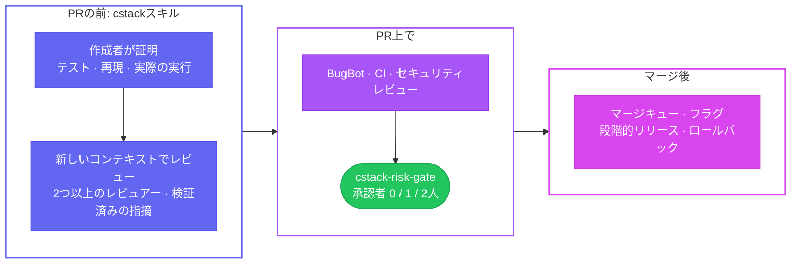

<div align="center">

<picture>
  <source media="(prefers-color-scheme: dark)" srcset="docs/assets/banner-dark.svg">
  
</picture>

<br/>

[](https://github.com/yulmucoffee/cstack/actions/workflows/ci.yml)
[](LICENSE)


[English](README.md) · [한국어](README.ko.md) · **日本語** · [简体中文](README.zh-CN.md) · [Español](README.es.md)

### 「このPRをレビューして」と言うだけで、細かい指摘の羅列ではなく、証拠付きのレビューが返ってきます。

**Claude Codeチームの働き方に、potetoのpstackのエージェント哲学を組み込みました。**<br/>
[Claude Codeチームのコードレビューの進め方](https://claude.dev/blog/solving-code-review-at-anthropic/): 多層的なレビュー、リスクに応じた人による承認、収束するレビュー。<br/>
[@poteto](https://github.com/poteto)の[pstack](https://github.com/cursor/plugins/tree/main/pstack): 小さなdiff、実際の環境での証明、複数モデルによる敵対的レビュー。

[クイックスタート](#クイックスタート) · [使い方](#使い方) · [仕組み](#仕組み) · [強制適用を有効にする](#強制適用を有効にする) · [エージェント向け](FOR_AGENTS.md)

</div>

> [!TIP]
> **セットアップはAIエージェントに任せましょう。** Claude Code、Codex、Cursorに次の文を貼り付けてください。
>
> ```text
> https://github.com/yulmucoffee/cstack/blob/main/FOR_AGENTS.md に従ってcstackをセットアップして
> ```
>
> エージェントはまず、自分だけで使うのか、リポジトリに導入するのかを尋ねます。その後インストールして結果を確認し、あなたにしか変更できないいくつかの設定を一覧にします。

## cstackを選ぶ理由

今やAIエージェントは、人が読むよりも速くプルリクエストを書きます。Claude Codeチームは[その対処法を公開しました](https://claude.dev/blog/solving-code-review-at-anthropic/)。読む作業の大半を機械に任せ、チェックを何層にも重ね、人による承認をリスクに合わせました。その結果、マージされたPRは2倍以上に増え、revertが必要になった割合は40%以上減りました。potetoの[pstack](https://github.com/cursor/plugins/tree/main/pstack)は、エージェントの出力が信頼に値するものになるよう、エージェントがどう働くべきかを扱っています。

cstackは、この2つを1分でインストールできるファイルにまとめたものです。

<table>
<tr>
<td width="33%" valign="top">

### 🔍 証拠付きのレビュー

「レビューして」と頼むたびに、同じプロンプトで異なるモデルのレビュアーを2つ動かします。次に、新しい検証役が各指摘を確認します。安全な場合はコードを実行して確かめます。届くのは検証を通過した指摘だけで、それぞれに`file:line`と証拠が付きます。

</td>
<td width="33%" valign="top">

### 🧭 いつもの環境で動く

**Claude Code**、**Codex**、**Cursor**で使える1つのスキルと、**Cursor BugBot**用のレビュールールです。サーバーもアカウントも不要です。リポジトリかホームフォルダに置く、ただのファイルです。

</td>
<td width="33%" valign="top">

### 🛡️ リスクに合わせた承認

オプションのGitHubチェックが、PRに必要な人の承認数を決めます。ドキュメントは0、コードは1です。CI、認証、課金、マイグレーション、外部の作成者は2です。

</td>
</tr>
</table>

## クイックスタート

Python 3.10以降と`git`が必要です。コマンドはbash、zsh、PowerShellで動きます。Windowsでは、`python3`と書かれているところで`py -3`を使ってください。

**方法A: エージェントに任せる。** 上のボックスのプロンプトを使ってください。エージェントは[FOR_AGENTS.md](FOR_AGENTS.md)に従って進めます。

**方法B: 自分だけ、すべてのリポジトリで**

```bash
git clone --depth 1 https://github.com/yulmucoffee/cstack.git "$HOME/.cstack/src"
```

```bash
python3 "$HOME/.cstack/src/scripts/install.py" --global
```

これで完了です。新しいエージェントセッションを開いて、「変更をレビューして」と伝えてください。

**方法C: チームのリポジトリに導入**

```bash
python3 "$HOME/.cstack/src/scripts/install.py" --target /path/to/repo
```

```bash
python3 "$HOME/.cstack/src/scripts/doctor.py" --target /path/to/repo
```

doctorが、何が設定済みで何が残っているかを表示します。結果をコミットしたら、[強制適用を有効にする](#強制適用を有効にする)を参照してください。

<details>
<summary><b>Claude Codeプラグインを使いたい場合</b></summary>

```text
/plugin marketplace add yulmucoffee/cstack
/plugin install cstack@cstack
```

この場合、スキルは`/cstack:cstack`になります。プラグインは`CLAUDE.md`を編集できないため、[`templates/routing.md`](templates/routing.md)の内容を`~/.claude/CLAUDE.md`に貼り付けてください。そうすれば、すべてのレビュー依頼がcstackに届きます。

</details>

## 使い方

どんな言葉でも、どの言語でも、そのまま頼んでください。スキル名を指定する必要はありません。

| こう言うと | こう動きます |
| --- | --- |
| 「PR 42をレビューして」「PR 42 리뷰해줘」 | **review**: PRと、適用されるリポジトリのルールを読みます。異なるモデルでレビュアーを2つ動かし、新しい検証役に各指摘を確認させます。結果はあなたに報告します。読み取り専用です。PRへの投稿は、頼んだときだけ行います。 |
| 「コミット前に変更を確認して」 | コミットしていない作業を**review**します。 |
| 「エクスポートボタンが二重送信される。直して」 | **fix**: まず再現し、根本原因を直し、修正前と修正後を示します。 |
| 「PR 42をグリーンにして」「BugBotのコメントに対応して」 | **babysit**: コンフリクト、スレッド、CIの順に対応します。マージ可能な状態で止まり、マージは決してしません。 |
| 「PR 41〜43をshipして」 | **ship**: 明示的に指示したときだけ動きます。検証済みのPRを、スタックの下から順にマージします。 |

`/code-review`、`/security-review`、Codexの`/review`などの組み込みコマンドも、そのまま使えます。cstackと一緒に頼むと、追加のパスとして実行されます。

<details>
<summary><b>レビューレポートの例</b></summary>

```text
MODE: review | VERDICT: BLOCKED | REF: 6c41928
FINDINGS: 2 actionable
  [ACT ON][high]   cart.py:4  coupon > subtotal -> negative total -> total([20], {amount: 50}) == -30 (CONFIRMED by verifier)
  [ACT ON][medium] cart.py:4  negative coupon amount raises the price -> {amount: -30} -> 50 (CONFIRMED by verifier)
DECLINED: percent coupons treated as flat: the change only adds flat coupons
PROOF: python3 repro.py -> both reproduced on the branch, absent on main
SAFETY FACT: callers without a coupon are unaffected: PROVED (ran both branches)
REVIEWERS: A=Anthropic/Sonnet, B=Anthropic/Opus, both found #1 and #2 | independence: same-vendor
NEXT: clamp at zero, validate the amount, add the four missing tests
```

指摘は、デモリポジトリで実際に実行した結果です。ただし、その実行は新しい検証ステップができる前のものなので、`CONFIRMED`タグはその実行の結果ではなく、現在の形式を示しています。レポートは、まず判定と件数を示し、各指摘に検証結果を付けます。見送ったものとその理由を挙げ、実際にレビューしたモデルを明記します。実際のレポートは、依頼した言語で出力されます。

</details>

<details>
<summary><b>良い依頼の書き方</b></summary>

pstackのプロンプトに関するアドバイスより:
- **入れるもの:** 目標、合否がはっきり分かれるチェック、見たい証拠、すでに分かっていること、実際の制約（「まず再現して」「マージしないで」）。
- **入れないもの:** やり方、手順のリスト、原因についての推測。
- **一言で軌道修正:** 「お願いしたのは再現で、修正はまだです。」

</details>

## 仕組み

レビューは層ごとに行われます。1つの層ですべてを捕まえる必要はありません。



**スキルが徹底すること**

- **主張ではなく証拠。** すべての主張に証拠を付けるか、`measured`、`inferred`、`guess`のラベルを付けます。
- **ドキュメント以外はレビュアー2つ。** 同じプロンプトを、異なるモデルで使います。diffが短くても例外にはなりません。変更行が約800行を超える場合、各レビュアーはdiffを部分ごとに分けて、順に確認します。
- **すべての指摘に新しい検証役。** ブロックできるのは、`CONFIRMED`で重大度がmedium以上の指摘だけです。未証明の重大度highの指摘があれば、判定は`PASS`ではなく`INCONCLUSIVE`になります。リードは、確認済みの正確性やセキュリティの指摘を覆せません。また、見送ったものはすべて一覧にします。
- **信頼できないコードは実行しません。** フォークや書き込み権限のない作成者からのテストやビルドは、あなたが承認した場合にだけ、しかもシークレットなしで実行します。それ以外の場合は、実行せずにコードを追って確認します。
- **ルールは適用される場所で。** PRが触れるすべてのディレクトリについて、ベースブランチから`CLAUDE.md`、`AGENTS.md`、`REVIEW.md`を読みます。規約に関する指摘には、そのルールを引用します。
- **安全性の根拠を1つ。** 変更が安全だと言える根拠となる唯一の事実を見つけ、コードを実行して証明します。証明できなければ`UNPROVEN`と書きます。
- **レビューは収束します。** 1つの問題につき最大3ラウンドまでです。最初のパスの後は新しいdiffだけを再レビューし、バグの種類を明示し、同じ指摘を繰り返しません。
- **babysitはshipではありません。** PRをグリーンにしても、マージはしません。

**ゲートが決めるリスク階層**

| 変更 | 信頼された作成者 | それ以外 |
| --- | :---: | :---: |
| ドキュメントのみ（`.md`、`.mdx`、`.rst`、`.adoc`、`docs/`内の画像） | 0 | 2 |
| コード、設定、依存関係、エージェントへの指示（`CLAUDE.md`、`AGENTS.md`、`REVIEW.md`、スキル） | 1 | 2 |
| CI、CODEOWNERS、`.cstack/`、BugBotの設定、エージェントのフック、auth、security、billing、payments、migrations、secrets、Terraform、lockfile | 2 | 2 |

どの階層でも、承認が数えられるのは次の条件をすべて満たす場合だけです。
- 現在のコミットに対する承認であること。
- リポジトリのowner、member、collaboratorによるもので、PRの作成者本人ではないこと。
- 未解決の変更リクエストがなく、すべてのレビュースレッドが解決済みであること。
- AIレビュアーのチェックが通過し（`neutral`ではなく`success`）、本物のGitHub Appから送られていること。

ゲートはフェイルクローズで動きます。APIエラー、ドラフトPR、壊れたポリシーは、いずれもマージをブロックします。詳しいルールは[docs/design.md](docs/design.md)にあります。

## 強制適用を有効にする

スキルはインストール直後から動きます。マージゲートは、GitHubで必須に設定するまで何も強制しません。doctorを実行すれば、いつでも現在の状況を確認できます。

- [ ] **まずインストールPRをマージします。** このPRの`cstack-risk-gate`チェックは失敗します。ベースブランチにまだゲートがないためです。このPRだけは、メンテナーが通常のレビューを経てマージします。
- [ ] **信頼するメンテナーを指定します。** `.cstack/policy.json`の`trusted_authors`に追加してください。指定するまでは、すべてのPRに2件の承認が必要です。
- [ ] **BugBotを有効にします。** Cursorのダッシュボードで、対象のリポジトリに対して有効にしてください。別のAIレビュアーを使う場合は、`required_check_names`と`required_check_apps`を変更してください。
- [ ] **ルールセットでチェックを必須にします。** [`templates/ruleset.json`](templates/ruleset.json)にCIのチェックを追加してから、下のコマンドを実行してください。Settings › Rulesで同じ設定をしてもかまいません。
- [ ] **ゲートを保護します。** `.github/workflows/`、`.cstack/`、`.cursor/`にCODEOWNERSを設定し、コードオーナーのレビューを必須にしてください。これがないと、PRがゲート自身のワークフローを書き換えられてしまいます。

```bash
gh api -X POST repos/OWNER/REPO/rulesets --input "$HOME/.cstack/src/templates/ruleset.json"
```

> [!IMPORTANT]
> cstackが自分でマージすることはありません。ゲートの通過は「マージしてよい」という意味で、「マージせよ」という意味ではありません。

## リファレンス

<details>
<summary><b>インストーラー: 何がどこに入るか</b></summary>

| リポジトリ内のパス | 種類 | 再インストール時 |
| --- | --- | --- |
| `.claude/skills/cstack/`, `.agents/skills/cstack/` | 管理対象 | 編集していなければアップグレード |
| `CLAUDE.md`, `AGENTS.md` | マーカーブロック | レビュールーティングのブロックだけを追加または置換 |
| `.cursor/BUGBOT.md` | マーカーブロック | cstackのブロックだけを置換 |
| `.cstack/gate.py`, `.github/workflows/cstack-gate.yml` | 管理対象 | 編集していなければアップグレード |
| `.cstack/policy.json`, `.cursor/config/bugbot.yaml`, `REVIEW.md`, `.github/pull_request_template.md` | シード | 一度だけ作成し、上書きしない |
| `.cstack/manifest.json` | 記録用 | 管理対象ファイルのハッシュ |

**オプション**

| フラグ | 内容 |
| --- | --- |
| `--global` | 個人用のインストール。スキルを`~/.claude/skills`と`~/.agents/skills`に、ルーティングブロックを`~/.claude/CLAUDE.md`と`~/.codex/AGENTS.md`に書き込みます（お使いのツールの分だけ）。 |
| `--no-gate` | ゲートのワークフロー、`gate.py`、`policy.json`をスキップします。 |
| `--no-routing` | `CLAUDE.md`と`AGENTS.md`には手を加えません。 |
| `--hosts claude,codex,cursor` | スキルの配置先を選びます。デフォルトの`claude,codex`でCursorもカバーされます。 |
| `--force` | 編集した管理対象ファイルも上書きします。シードファイルは決して上書きしません。 |
| `--dry-run` | 何が変わるかを表示します。 |

`@AGENTS.md`をインポートするだけの`CLAUDE.md`には手を加えません。GitHubが参照するいずれかの場所にPRテンプレートがすでにあれば、それを尊重します。

</details>

<details>
<summary><b><code>policy.json</code>のキー</b></summary>

| キー | デフォルト | 意味 |
| --- | --- | --- |
| `trusted_authors` | `[]` | 軽い階層が適用されるGitHubのログイン名。大文字と小文字は区別しません。 |
| `additional_high_risk_patterns` | `infra/**`, `**/deploy/**`, `**/production/**` | 常に2人の承認が必要な追加のパス。 |
| `required_check_names` | `["Cursor Bugbot"]` | 結果が`success`でなければならないチェック。 |
| `required_check_apps` | `{"Cursor Bugbot": "cursor"}` | このGitHub Appが発行したチェックだけを数えます。 |
| `approver_associations` | `OWNER`, `MEMBER`, `COLLABORATOR` | 誰の承認を数えるか。 |
| `require_resolved_review_threads` | `true` | 未解決のスレッドがあればブロックします。 |
| `check_wait_seconds` | `600` | まだ実行中の必須チェックを待つ時間。 |

</details>

<details>
<summary><b>アップグレード</b></summary>

```bash
git -C "$HOME/.cstack/src" pull --ff-only
```

```bash
python3 "$HOME/.cstack/src/scripts/install.py" --target /path/to/repo
```

編集していないファイルは自動でアップグレードされます。編集したファイルはコンフリクトとして報告されます。シードファイルはあなたのものとして残るので、新しいキーがないか`templates/policy.json`と比べてください。

</details>

<details>
<summary><b>リポジトリの構成</b></summary>

```text
skills/cstack/            スキル本体: SKILL.md、リファレンス、Codexのメタデータ
FOR_AGENTS.md             AIエージェント向けのセットアップ手順
scripts/install.py        インストーラー（標準ライブラリのみ）
scripts/doctor.py         セットアップの確認（標準ライブラリ、ghがあれば使用）
scripts/gate.py           マージゲート（標準ライブラリのみ）
templates/                ゲートのワークフロー、デフォルトのポリシー、ルールセット、REVIEW.md、ルーティングブロック
.cursor/                  BugBotのルールと設定
.claude-plugin/           Claude Codeプラグインのマニフェスト
docs/design.md            信頼境界と既知の制限
tests/                    ゲート、インストーラー、doctorのテスト
```

</details>

<details>
<summary><b>開発</b></summary>

```bash
python3 -m unittest discover -s tests -v
```

何も書き込まずに、実際のPRでゲートを試すには:

```bash
GH_TOKEN="$(gh auth token)" GITHUB_REPOSITORY=owner/repo PR_NUMBER=123 CSTACK_CONFIG=templates/policy.json python3 scripts/gate.py
```

IssueやPRを歓迎します。スキルを変更する場合は、それがエージェントの振る舞いをどう変えるかを示してください。できれば、実際のタスクでの変更前と変更後を添えてください。

</details>

## クレジット

- Addy Osmani、Morgan Westlee Lunt、Qing Wang、[How the Claude Code team does code review](https://claude.dev/blog/solving-code-review-at-anthropic/)（2026年10月15日）。
- Lauren Tan（[poteto](https://github.com/poteto)）、[pstack](https://github.com/cursor/plugins/tree/main/pstack)、MIT。原則、レビューの基準、BugBotのトリアージ、shipの規律は、これを元にしています。[NOTICE.md](NOTICE.md)を参照してください。

cstackは独立したプロジェクトであり、Anthropic、Cursor、OpenAIとは提携しておらず、承認も受けていません。[MIT License](LICENSE)。
