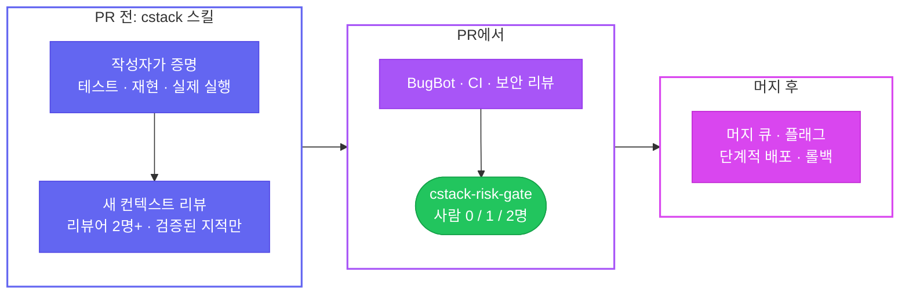

<div align="center">

<picture>
  <source media="(prefers-color-scheme: dark)" srcset="assets/banner-dark.svg">
  
</picture>

<br/>

[](https://github.com/yulmucoffee/cstack/actions/workflows/ci.yml)
[](LICENSE)


[English](README.md) · **한국어**

### "이 PR 리뷰해줘" 한마디면, 지적의 나열이 아니라 증거가 붙은 리뷰가 옵니다.

[빠른 시작](#빠른-시작) · [사용법](#사용법) · [동작 방식](#동작-방식) · [강제 적용 켜기](#강제-적용-켜기) · [에이전트용 안내](FOR_AGENTS.md)

</div>

> [!TIP]
> **설치는 AI 에이전트에게 맡기세요.** Claude Code, Codex, Cursor에 이렇게 붙여 넣으면 됩니다.
>
> ```text
> https://github.com/yulmucoffee/cstack/blob/main/FOR_AGENTS.md 를 따라서 cstack 세팅해줘
> ```
>
> 에이전트가 나만 쓸지, 이 레포에 적용할지를 먼저 묻습니다. 그다음 설치하고 결과를 점검한 뒤, 직접 바꿔야 하는 몇 가지 설정을 정리해 줍니다.

## 왜 cstack인가

이제 AI 에이전트가 사람이 다 읽을 수 없을 만큼 빠르게 PR을 만듭니다. Claude Code 팀은 이 문제를 [어떻게 다루는지 공개했습니다](https://claude.dev/blog/solving-code-review-at-anthropic/). 읽는 일의 대부분을 기계에 넘기고, 검사를 여러 겹으로 쌓고, 사람 승인을 위험도에 맞췄습니다. 그 결과 머지된 PR은 두 배 넘게 늘었고, 되돌린 PR의 비율은 40% 넘게 줄었습니다. poteto의 [pstack](https://github.com/cursor/plugins/tree/main/pstack)은 에이전트가 신뢰받을 결과를 내려면 어떻게 일해야 하는지를 다룹니다.

cstack은 이 둘을 1분이면 설치하는 파일로 묶었습니다.

<table>
<tr>
<td width="33%" valign="top">

### 🔍 증거가 붙은 리뷰

"리뷰해줘"라고 하면 가능하면 서로 다른 모델로 독립 리뷰어 2명을 돌립니다. 발견 사항은 코드를 실행해서 하나씩 확인합니다. 살아남은 지적만, `file:line`과 재현 방법을 붙여서 받습니다.

</td>
<td width="33%" valign="top">

### 🧭 쓰던 도구 그대로

**Claude Code**, **Codex**, **Cursor**에서 같은 스킬 하나를 쓰고, **Cursor BugBot**용 리뷰 규칙도 들어 있습니다. 서버도 계정도 필요 없습니다. 레포나 홈 폴더에 들어가는 평범한 파일입니다.

</td>
<td width="33%" valign="top">

### 🛡️ 위험도에 맞는 승인

선택 사항인 GitHub 체크가 PR마다 필요한 사람 승인 수를 정합니다. 문서는 0명, 코드는 1명입니다. CI, 인증, 결제, 마이그레이션, 외부 작성자는 2명입니다.

</td>
</tr>
</table>

## 빠른 시작

Python 3.10 이상과 `git`이 필요합니다.

**방법 A: 에이전트에게 맡기기.** 위 박스의 문장을 그대로 쓰세요. 에이전트가 [FOR_AGENTS.md](FOR_AGENTS.md)를 따라 진행합니다.

**방법 B: 나만, 모든 레포에서**

```bash
git clone --depth 1 https://github.com/yulmucoffee/cstack.git ~/.cstack/src
```

```bash
python3 ~/.cstack/src/scripts/install.py --global
```

이걸로 끝입니다. 에이전트 세션을 새로 열고 "내 변경사항 리뷰해줘"라고 해 보세요.

**방법 C: 팀 레포에 적용**

```bash
python3 ~/.cstack/src/scripts/install.py --target /path/to/repo
```

```bash
python3 ~/.cstack/src/scripts/doctor.py --target /path/to/repo
```

doctor가 무엇이 준비됐고 무엇이 남았는지 보여 줍니다. 결과를 커밋한 뒤 [강제 적용 켜기](#강제-적용-켜기)를 보세요.

<details>
<summary><b>Claude Code 플러그인으로 설치하고 싶다면</b></summary>

```text
/plugin marketplace add yulmucoffee/cstack
/plugin install cstack@cstack
```

이 경우 스킬 이름은 `/cstack:cstack`입니다. 플러그인은 `CLAUDE.md`를 수정할 수 없습니다. [`templates/routing.md`](templates/routing.md)의 내용을 `~/.claude/CLAUDE.md`에 붙여 넣어야 모든 리뷰 요청이 cstack으로 갑니다.

</details>

## 사용법

어떤 말로든, 어떤 언어로든 그냥 요청하세요. 스킬 이름을 부를 필요가 없습니다.

| 이렇게 말하면 | 이렇게 동작합니다 |
| --- | --- |
| "이 PR 리뷰해줘", "review PR 42" | **review**: PR을 읽고 독립 리뷰어 2명을 돌립니다. 지적은 코드를 실행해서 확인한 뒤 보고합니다. 읽기 전용이고, PR 코멘트는 요청할 때만 답니다. |
| "커밋 전에 내 변경사항 봐줘" | 커밋하지 않은 변경을 **review**합니다. |
| "내보내기 버튼이 두 번 눌려. 고쳐줘" | **fix**: 먼저 재현하고 근본 원인을 고친 뒤 전후를 보여 줍니다. |
| "PR 42 초록불 만들어줘", "BugBot 코멘트 처리해줘" | **babysit**: 충돌, 리뷰 스레드, CI 순서로 처리합니다. merge-ready에서 멈추고 절대 머지하지 않습니다. |
| "PR 41~43 ship해줘" | **ship**: 명시적으로 요청할 때만 합니다. 스택 아래부터 검증된 PR만 머지합니다. |

`/code-review`, `/security-review`, Codex `/review` 같은 내장 명령도 그대로 쓰입니다. cstack이 자기 절차 안에서 리뷰어 중 하나로 돌립니다.

<details>
<summary><b>리뷰 보고서 예시</b></summary>

```text
MODE: review | VERDICT: BLOCKED | REF: 6c41928
FINDINGS: 2 actionable
  [ACT ON][high]   cart.py:4  coupon > subtotal -> negative total -> repro: total([20], {amount: 50}) == -30
  [ACT ON][medium] cart.py:4  negative coupon amount raises the price -> repro: {amount: -30} -> 50
PROOF: python3 repro.py -> both reproduced on the branch, absent on main
SAFETY FACT: callers without a coupon are unaffected: PROVED (ran both branches)
INDEPENDENCE: Sonnet reviewer + Opus reviewer, both found #1 and #2
NEXT: clamp at zero, validate the amount, add the four missing tests
```

데모 레포에서 실제로 돌린 결과입니다. 판정과 개수가 맨 앞에 오고, 증거가 붙고, 실제로 확보한 독립성을 밝히는 순서를 보여 줍니다. 실제 보고는 요청한 언어로 나옵니다.

</details>

<details>
<summary><b>좋은 요청을 쓰는 법</b></summary>

pstack의 프롬프팅 조언을 따릅니다.
- **넣을 것:** 목표, 통과와 실패가 갈리는 완료 기준, 보고 싶은 증거, 이미 아는 것, 실제 제약("재현부터", "머지하지 마").
- **뺄 것:** 구현 방법, 단계 목록, 원인에 대한 추측.
- **한 줄로 방향 잡기:** "재현해 달라고 했지, 아직 고치라고 하지 않았어."

</details>

## 동작 방식

리뷰는 여러 겹으로 이뤄집니다. 어느 한 겹이 모든 걸 잡을 필요는 없습니다.



**스킬이 반드시 지키는 것**

- **주장이 아니라 증거.** 모든 주장에 증거를 붙이거나 `measured`, `inferred`, `guess`로 표시합니다.
- **문서가 아니면 리뷰어 2명.** 짧은 diff도 예외가 아닙니다. 실제로 확보한 독립성을 그대로 밝힙니다.
- **보고 전 검증.** 스타일 지적은 버립니다. PR 전부터 있던 버그는 따로 표시해서 작성자 탓처럼 보이지 않게 합니다.
- **안전의 단 하나의 근거.** 변경이 안전한 단 하나의 사실을 찾아 코드를 실행해서 증명합니다. 증명하지 못하면 `UNPROVEN`이라고 씁니다.
- **리뷰는 수렴합니다.** 같은 문제로는 최대 세 번까지만 돕니다. 첫 패스 이후에는 새 diff만 보고, 버그 유형을 짚고, 같은 지적을 반복하지 않습니다.
- **babysit은 ship이 아닙니다.** PR을 초록불로 만들어도 머지는 하지 않습니다.

**게이트가 정하는 위험 등급**

| 변경 | 신뢰 작성자 | 그 외 |
| --- | :---: | :---: |
| 문서만 (`.md`, `.mdx`, `.rst`, `.adoc`, `docs/` 안의 이미지) | 0 | 2 |
| 코드, 설정, 의존성, 에이전트 지침 (`CLAUDE.md`, `AGENTS.md`, `REVIEW.md`, 스킬) | 1 | 2 |
| CI, CODEOWNERS, `.cstack/`, BugBot 설정, 에이전트 훅, auth, security, billing, payments, migrations, secrets, Terraform, lockfile | 2 | 2 |

모든 등급에서 승인은 다음 조건을 모두 채워야 셉니다.
- 현재 커밋에 대한 승인이어야 합니다.
- 레포 owner, member, collaborator의 승인이어야 하고, PR 작성자 본인은 안 됩니다.
- 남은 변경 요청이 없고, 모든 리뷰 스레드가 해결돼 있어야 합니다.
- AI 리뷰어 체크가 실제 GitHub App에서 와서 통과(`success`, `neutral`은 통과가 아님)해야 합니다.

게이트는 실패하면 막는 쪽으로 동작합니다. API 오류, draft PR, 잘못된 정책 파일은 모두 머지를 막습니다. 전체 규칙은 [docs/design.md](docs/design.md)에 있습니다.

## 강제 적용 켜기

스킬은 설치하자마자 동작합니다. 머지 게이트는 GitHub에서 필수로 지정하기 전까지 아무것도 막지 않습니다. 언제든 doctor를 돌려 어디까지 왔는지 확인할 수 있습니다.

- [ ] **설치 PR부터 머지하세요.** 이 PR의 `cstack-risk-gate` 체크는 실패합니다. base 브랜치에 아직 게이트가 없기 때문입니다. 이 PR 하나는 메인테이너가 평소처럼 리뷰해서 머지합니다.
- [ ] **신뢰 메인테이너를 지정하세요.** `.cstack/policy.json`의 `trusted_authors`에 넣습니다. 지정하기 전까지는 모든 PR에 승인 2개가 필요합니다.
- [ ] **BugBot을 켜세요.** Cursor 대시보드에서 해당 레포를 켭니다. 다른 AI 리뷰어를 쓴다면 `required_check_names`와 `required_check_apps`를 바꾸세요.
- [ ] **룰셋으로 체크를 필수로 지정하세요.** [`templates/ruleset.json`](templates/ruleset.json)에 레포의 CI 체크를 추가한 뒤 아래 명령을 실행합니다. Settings › Rules에서 같은 설정을 직접 해도 됩니다.
- [ ] **게이트를 보호하세요.** `.github/workflows/`, `.cstack/`, `.cursor/`에 CODEOWNERS를 걸고 코드 오너 리뷰를 필수로 하세요. 그러지 않으면 PR이 게이트 워크플로 자체를 고칠 수 있습니다.

```bash
gh api -X POST repos/OWNER/REPO/rulesets --input ~/.cstack/src/templates/ruleset.json
```

> [!IMPORTANT]
> cstack은 스스로 머지하지 않습니다. 게이트 통과는 "머지해도 된다"는 뜻이지 "머지하라"는 뜻이 아닙니다.

## 참고

<details>
<summary><b>설치 스크립트: 무엇이 어디에 들어가나</b></summary>

| 대상 레포의 경로 | 종류 | 다시 설치할 때 |
| --- | --- | --- |
| `.claude/skills/cstack/`, `.agents/skills/cstack/` | 관리 파일 | 직접 수정하지 않았으면 업그레이드 |
| `CLAUDE.md`, `AGENTS.md` | 마커 블록 | 리뷰 라우팅 블록만 추가하거나 교체 |
| `.cursor/BUGBOT.md` | 마커 블록 | cstack 블록만 교체 |
| `.cstack/gate.py`, `.github/workflows/cstack-gate.yml` | 관리 파일 | 직접 수정하지 않았으면 업그레이드 |
| `.cstack/policy.json`, `.cursor/config/bugbot.yaml`, `REVIEW.md`, `.github/pull_request_template.md` | 시드 파일 | 한 번만 만들고 절대 덮어쓰지 않음 |
| `.cstack/manifest.json` | 기록용 | 관리 파일의 해시 |

**옵션**

| 옵션 | 하는 일 |
| --- | --- |
| `--global` | 개인 설치. 스킬은 `~/.claude/skills`와 `~/.agents/skills`에, 라우팅 블록은 설치된 도구에 한해 `~/.claude/CLAUDE.md`와 `~/.codex/AGENTS.md`에 넣습니다. |
| `--no-gate` | 게이트 워크플로, `gate.py`, `policy.json`을 건너뜁니다. |
| `--no-routing` | `CLAUDE.md`와 `AGENTS.md`를 건드리지 않습니다. |
| `--hosts claude,codex,cursor` | 스킬 위치를 고릅니다. 기본값 `claude,codex`로 Cursor도 함께 지원됩니다. |
| `--force` | 직접 수정한 관리 파일을 덮어씁니다. 시드 파일은 절대 덮어쓰지 않습니다. |
| `--dry-run` | 바뀔 내용만 보여 줍니다. |

`@AGENTS.md`만 불러오는 `CLAUDE.md`는 건드리지 않습니다. GitHub가 찾는 위치에 PR 템플릿이 이미 있으면 그대로 둡니다.

</details>

<details>
<summary><b><code>policy.json</code> 키</b></summary>

| 키 | 기본값 | 의미 |
| --- | --- | --- |
| `trusted_authors` | `[]` | 가벼운 등급을 받는 GitHub 로그인. 대소문자 구분 없음. |
| `additional_high_risk_patterns` | `infra/**`, `**/deploy/**`, `**/production/**` | 항상 사람 2명이 필요한 추가 경로. |
| `required_check_names` | `["Cursor Bugbot"]` | `success`여야 하는 체크. |
| `required_check_apps` | `{"Cursor Bugbot": "cursor"}` | 이 GitHub App이 발행한 체크만 인정. |
| `approver_associations` | `OWNER`, `MEMBER`, `COLLABORATOR` | 승인으로 인정할 관계. |
| `require_resolved_review_threads` | `true` | 미해결 스레드가 있으면 차단. |
| `check_wait_seconds` | `600` | 실행 중인 필수 체크를 기다리는 시간. |

</details>

<details>
<summary><b>업그레이드</b></summary>

```bash
git -C ~/.cstack/src pull --ff-only
```

```bash
python3 ~/.cstack/src/scripts/install.py --target /path/to/repo
```

수정하지 않은 파일은 자동으로 업그레이드되고, 수정한 파일은 충돌로 알려 줍니다. 시드 파일은 여러분 소유라 갱신되지 않으니, 새 키가 생겼는지 `configs/policy.json`과 비교하세요.

</details>

<details>
<summary><b>레포 구조</b></summary>

```text
skills/cstack/            스킬: SKILL.md, 레퍼런스, Codex 메타데이터
FOR_AGENTS.md             AI 에이전트용 단계별 설치 안내
scripts/install.py        설치 스크립트 (표준 라이브러리만)
scripts/doctor.py         설치 점검 (표준 라이브러리, gh가 있으면 사용)
scripts/gate.py           머지 게이트 (표준 라이브러리만)
templates/                게이트 워크플로, 룰셋, REVIEW.md, 라우팅 블록
configs/policy.json       기본 게이트 정책
.cursor/                  BugBot 규칙과 설정
.claude-plugin/           Claude Code 플러그인 매니페스트
docs/design.md            신뢰 경계와 알려진 한계
tests/                    게이트, 설치, doctor 테스트
```

</details>

<details>
<summary><b>개발</b></summary>

```bash
python3 -m unittest discover -s tests -v
```

아무것도 쓰지 않고 실제 PR에 게이트를 돌려 보려면:

```bash
GH_TOKEN="$(gh auth token)" GITHUB_REPOSITORY=owner/repo PR_NUMBER=123 CSTACK_CONFIG=configs/policy.json python3 scripts/gate.py
```

이슈와 PR 환영합니다. 스킬을 바꾸는 PR에는 그 변경이 에이전트 행동을 어떻게 바꾸는지, 가능하면 실제 작업에서의 전후 비교를 함께 적어 주세요.

</details>

## 출처

- Addy Osmani, Morgan Westlee Lunt, Qing Wang, [How the Claude Code team does code review](https://claude.dev/blog/solving-code-review-at-anthropic/) (2026년 10월 15일).
- Lauren Tan ([poteto](https://github.com/poteto)), [pstack](https://github.com/cursor/plugins/tree/main/pstack), MIT. 원칙, 리뷰 루브릭, BugBot 분류, 머지 규율을 가져와 다시 썼습니다. [NOTICE.md](NOTICE.md)를 참고하세요.

cstack은 독립 프로젝트이며 Anthropic, Cursor, OpenAI와 제휴하거나 보증받지 않았습니다. [MIT License](LICENSE).
