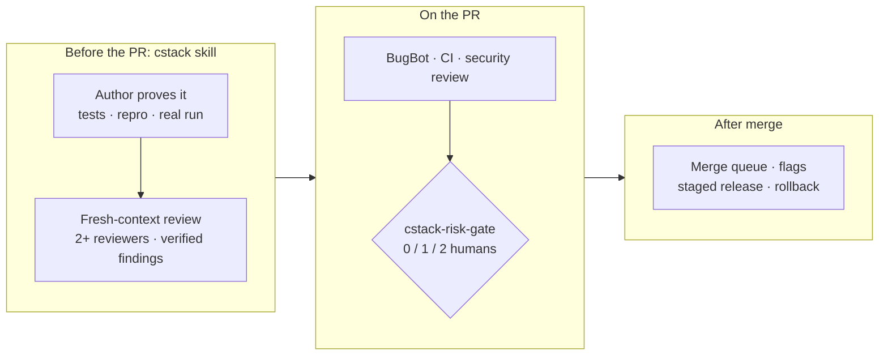

<div align="center">

<picture>
  <source media="(prefers-color-scheme: dark)" srcset="assets/banner-dark.svg">
  
</picture>

<br/>

[](https://github.com/yulmucoffee/cstack/actions/workflows/ci.yml)
[](LICENSE)


**English** · [한국어](README.ko.md)

### Say "review this PR". Get a review with proof, not a wall of nits.

[Quick start](#quick-start) · [Use it](#use-it) · [How it works](#how-it-works) · [Turn on enforcement](#turn-on-enforcement) · [For agents](FOR_AGENTS.md)

</div>

> [!TIP]
> **Let your AI agent set it up.** Paste this into Claude Code, Codex or Cursor:
>
> ```text
> Set up cstack for me by following https://github.com/yulmucoffee/cstack/blob/main/FOR_AGENTS.md
> ```
>
> The agent asks whether you want it for yourself or for a repository. Then it installs, checks the result, and lists the few settings only you can change.

## Why cstack

AI agents now write pull requests faster than people can read them. The Claude Code team [shared how they handle that](https://claude.dev/blog/solving-code-review-at-anthropic/). They moved most of the reading to machines, layered the checks, and matched human approval to risk. Merged PRs more than doubled, and the share that had to be reverted fell by more than 40 percent. poteto's [pstack](https://github.com/cursor/plugins/tree/main/pstack) covers how an agent should work so its output deserves trust.

cstack packs both into files you install in a minute.

<table>
<tr>
<td width="33%" valign="top">

### 🔍 Reviews with proof

Every "review this" runs two independent reviewers, ideally on different models. Each finding is checked by running the code. You get only the findings that survived, each with a `file:line` and a repro.

</td>
<td width="33%" valign="top">

### 🧭 Works where you are

One skill for **Claude Code**, **Codex** and **Cursor**, plus review rules for **Cursor BugBot**. No server and no account. Plain files in your repo or home folder.

</td>
<td width="33%" valign="top">

### 🛡️ Approval that matches risk

An optional GitHub check sets the number of human approvals a PR needs: 0 for docs, 1 for code, 2 for CI, auth, billing, migrations or outside authors.

</td>
</tr>
</table>

## Quick start

You need Python 3.10 or later and `git`.

**Option A: let your agent do it.** Use the prompt in the box above. The agent follows [FOR_AGENTS.md](FOR_AGENTS.md).

**Option B: just for me, in every repository**

```bash
git clone --depth 1 https://github.com/yulmucoffee/cstack.git ~/.cstack/src
```

```bash
python3 ~/.cstack/src/scripts/install.py --global
```

That's it. Open a new agent session and say "review my changes".

**Option C: for my team's repository**

```bash
python3 ~/.cstack/src/scripts/install.py --target /path/to/repo
```

```bash
python3 ~/.cstack/src/scripts/doctor.py --target /path/to/repo
```

The doctor shows what is set up and what is left. Commit the result, then see [Turn on enforcement](#turn-on-enforcement).

<details>
<summary><b>Prefer the Claude Code plugin?</b></summary>

```text
/plugin marketplace add yulmucoffee/cstack
/plugin install cstack@cstack
```

The skill is then `/cstack:cstack`. A plugin cannot edit `CLAUDE.md`, so paste the text of [`templates/routing.md`](templates/routing.md) into `~/.claude/CLAUDE.md`. That way every review request reaches cstack.

</details>

## Use it

Just ask, in any words and any language. You do not need to name the skill.

| You say | What happens |
| --- | --- |
| "Review this PR", "PR 42 리뷰해줘" | **review**: reads the PR and runs two independent reviewers. Verifies each finding by running code. Reports to you. Read-only. Posts to the PR only if you ask. |
| "Check my changes before I commit" | **review** of your uncommitted work. |
| "The export button double-submits. Fix it." | **fix**: reproduces it first, fixes the root cause, shows before and after. |
| "Get PR 42 green", "Address the BugBot comments" | **babysit**: conflicts, then threads, then CI. Stops at merge-ready and never merges. |
| "Ship PRs 41 to 43" | **ship**: only when you say so explicitly. Lands the verified PRs from the bottom of the stack. |

Built-in commands such as `/code-review`, `/security-review` and Codex `/review` still work. cstack runs them as reviewers inside its own process.

<details>
<summary><b>What a review report looks like</b></summary>

```text
MODE: review | VERDICT: BLOCKED | REF: 6c41928
FINDINGS: 2 actionable
  [ACT ON][high]   cart.py:4  coupon > subtotal -> negative total -> repro: total([20], {amount: 50}) == -30
  [ACT ON][medium] cart.py:4  negative coupon amount raises the price -> repro: {amount: -30} -> 50
PROOF: python3 repro.py -> both reproduced on the branch, absent on main
SAFETY FACT: callers without a coupon are unaffected: PROVED (ran both branches)
INDEPENDENCE: Sonnet reviewer + Opus reviewer, both found #1 and #2
NEXT: clamp at zero, validate the amount, add the four missing tests
```

This is a real run on a demo repository. It shows the order of a report: verdict and count first, proof attached, and the independence it actually had.

</details>

<details>
<summary><b>How to write a good request</b></summary>

From pstack's prompting advice:
- **Put in:** the goal, a check that can pass or fail, the proof you want to see, what you already know, and real limits ("repro first", "don't merge").
- **Leave out:** how to do it, a list of steps, and your guess at the cause.
- **Steer in one line:** "I asked for a repro, not a fix yet."

</details>

## How it works

Review happens in layers. No single layer has to catch everything.



**What the skill insists on**

- **Proof, not claims.** Every claim carries its evidence or is labeled `measured`, `inferred` or `guess`.
- **Two reviewers for anything but docs.** A short diff is not an exception. The skill reports the independence it actually had.
- **Verify before reporting.** Style-only findings are dropped. Bugs that existed before the PR are labeled, so they do not read as the author's fault.
- **One safety fact.** It finds the single fact the change is safe because of and proves it by running code, or says `UNPROVEN`.
- **Reviews converge.** At most three rounds on one problem. After the first pass it re-reviews only the new diff, names the bug class, and never repeats a finding.
- **Babysit is not ship.** Getting a PR green never merges it.

**Risk tiers set by the gate**

| Change | Trusted author | Anyone else |
| --- | :---: | :---: |
| Docs only (`.md`, `.mdx`, `.rst`, `.adoc`, images in `docs/`) | 0 | 2 |
| Code, config, dependencies, agent instructions (`CLAUDE.md`, `AGENTS.md`, `REVIEW.md`, skills) | 1 | 2 |
| CI, CODEOWNERS, `.cstack/`, BugBot config, agent hooks, auth, security, billing, payments, migrations, secrets, Terraform, lockfiles | 2 | 2 |

On every tier, approvals count only when they meet all of these:
- They are on the current commit.
- They come from repository owners, members or collaborators, never the PR's author.
- No change request is standing, and every review thread is resolved.
- The AI reviewer's check passed (`success`, not `neutral`) and came from its real GitHub App.

The gate fails closed: an API error, a draft PR or a broken policy blocks the merge. Full rules are in [docs/design.md](docs/design.md).

## Turn on enforcement

The skill works right after install. The merge gate enforces nothing until GitHub requires it. Run the doctor at any time to see where you are.

- [ ] **Merge the install PR first.** Its `cstack-risk-gate` check fails, because the base branch does not have the gate yet. A maintainer merges this one PR with normal review.
- [ ] **Name trusted maintainers** in `.cstack/policy.json` under `trusted_authors`. Until then every PR needs two approvals.
- [ ] **Enable BugBot** for the repository in the Cursor dashboard. If you use another AI reviewer, change `required_check_names` and `required_check_apps`.
- [ ] **Require the checks** with a ruleset. Add your CI checks to [`templates/ruleset.json`](templates/ruleset.json), then run the command below, or set the same thing up in Settings › Rules.
- [ ] **Protect the gate.** Add CODEOWNERS for `.github/workflows/`, `.cstack/` and `.cursor/`, and require code-owner review. Without it, a PR could edit the gate's own workflow.

```bash
gh api -X POST repos/OWNER/REPO/rulesets --input ~/.cstack/src/templates/ruleset.json
```

> [!IMPORTANT]
> cstack never merges on its own. A passing gate means "allowed", not "go".

## Reference

<details>
<summary><b>Installer: what goes where</b></summary>

| Path in your repo | Kind | On reinstall |
| --- | --- | --- |
| `.claude/skills/cstack/`, `.agents/skills/cstack/` | managed | upgraded if you have not edited it |
| `CLAUDE.md`, `AGENTS.md` | marked block | only the review-routing block is added or replaced |
| `.cursor/BUGBOT.md` | marked block | only the cstack block is replaced |
| `.cstack/gate.py`, `.github/workflows/cstack-gate.yml` | managed | upgraded if you have not edited it |
| `.cstack/policy.json`, `.cursor/config/bugbot.yaml`, `REVIEW.md`, `.github/pull_request_template.md` | seed | created once, never overwritten |
| `.cstack/manifest.json` | bookkeeping | hashes of managed files |

**Options**

| Flag | What it does |
| --- | --- |
| `--global` | Personal install. Writes the skill to `~/.claude/skills` and `~/.agents/skills`, and the routing block to `~/.claude/CLAUDE.md` and `~/.codex/AGENTS.md` for tools you have. |
| `--no-gate` | Skips the gate workflow, `gate.py` and `policy.json`. |
| `--no-routing` | Leaves `CLAUDE.md` and `AGENTS.md` alone. |
| `--hosts claude,codex,cursor` | Picks skill locations. The default `claude,codex` also covers Cursor. |
| `--force` | Overwrites managed files you edited. Seed files are never overwritten. |
| `--dry-run` | Shows what would change. |

A `CLAUDE.md` that only imports `@AGENTS.md` is left alone. An existing PR template anywhere GitHub looks is respected.

</details>

<details>
<summary><b><code>policy.json</code> keys</b></summary>

| Key | Default | Meaning |
| --- | --- | --- |
| `trusted_authors` | `[]` | GitHub logins that get the lighter tiers. Case-insensitive. |
| `additional_high_risk_patterns` | `infra/**`, `**/deploy/**`, `**/production/**` | Extra paths that always need two humans. |
| `required_check_names` | `["Cursor Bugbot"]` | Checks that must conclude `success`. |
| `required_check_apps` | `{"Cursor Bugbot": "cursor"}` | Only count a check published by this GitHub App. |
| `approver_associations` | `OWNER`, `MEMBER`, `COLLABORATOR` | Whose approvals count. |
| `require_resolved_review_threads` | `true` | Block on unresolved threads. |
| `check_wait_seconds` | `600` | How long to wait for required checks still running. |

</details>

<details>
<summary><b>Upgrading</b></summary>

```bash
git -C ~/.cstack/src pull --ff-only
```

```bash
python3 ~/.cstack/src/scripts/install.py --target /path/to/repo
```

Files you have not edited upgrade automatically. Edited ones are reported as conflicts. Seed files stay yours, so compare them with `configs/policy.json` for new keys.

</details>

<details>
<summary><b>Repository layout</b></summary>

```text
skills/cstack/            the skill: SKILL.md, references, Codex metadata
FOR_AGENTS.md             step-by-step setup for AI agents
scripts/install.py        installer (stdlib only)
scripts/doctor.py         setup checker (stdlib, uses gh if present)
scripts/gate.py           the merge gate (stdlib only)
templates/                gate workflow, ruleset, REVIEW.md, routing block
configs/policy.json       default gate policy
.cursor/                  BugBot rules and config
.claude-plugin/           Claude Code plugin manifests
docs/design.md            trust boundaries and known limits
tests/                    gate, installer and doctor tests
```

</details>

<details>
<summary><b>Development</b></summary>

```bash
python3 -m unittest discover -s tests -v
```

Try the gate on a real PR without writing anything:

```bash
GH_TOKEN="$(gh auth token)" GITHUB_REPOSITORY=owner/repo PR_NUMBER=123 CSTACK_CONFIG=configs/policy.json python3 scripts/gate.py
```

Issues and PRs are welcome. For a change to the skill, show how it changes agent behavior, ideally with a before and after on a real task.

</details>

## Credits

- Addy Osmani, Morgan Westlee Lunt and Qing Wang, [How the Claude Code team does code review](https://claude.dev/blog/solving-code-review-at-anthropic/) (October 15, 2026).
- Lauren Tan ([poteto](https://github.com/poteto)), [pstack](https://github.com/cursor/plugins/tree/main/pstack), MIT. The principles, review rubric, BugBot triage and shipping discipline are adapted from it. See [NOTICE.md](NOTICE.md).

cstack is independent and not affiliated with or endorsed by Anthropic, Cursor or OpenAI. [MIT License](LICENSE).
