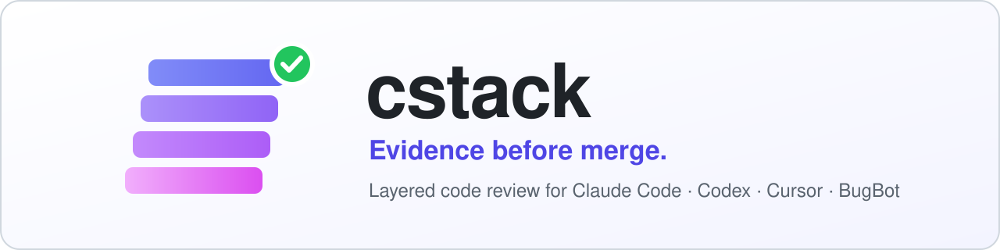
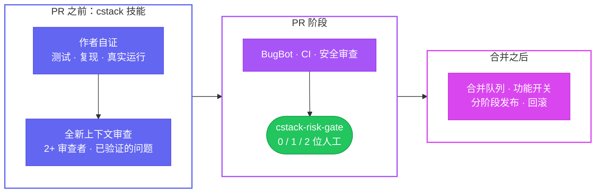

<div align="center">

<picture>
  <source media="(prefers-color-scheme: dark)" srcset="docs/assets/banner-dark.svg">
  
</picture>

<br/>

[](https://github.com/yulmucoffee/cstack/actions/workflows/ci.yml)
[](LICENSE)


[English](README.md) · [한국어](README.ko.md) · [日本語](README.ja.md) · **简体中文** · [Español](README.es.md)

### 说一句“审查这个 PR”，拿到的是带证据的审查，而不是一长串琐碎意见。

**Claude Code 团队的工作方式，并内置 poteto 的 pstack 智能体理念。**<br/>
[Claude Code 团队如何做代码审查](https://claude.dev/blog/solving-code-review-at-anthropic/)：分层审查、按风险分级的人工批准、能够收敛的审查。<br/>
[@poteto](https://github.com/poteto) 的 [pstack](https://github.com/cursor/plugins/tree/main/pstack)：小 diff、在真实环境中给出证明、多模型对抗式审查。

[快速开始](#快速开始) · [使用方法](#使用方法) · [工作原理](#工作原理) · [开启强制执行](#开启强制执行) · [面向智能体](FOR_AGENTS.md)

</div>

> [!TIP]
> **让 AI 智能体帮你安装。** 把下面这句粘贴到 Claude Code、Codex 或 Cursor：
>
> ```text
> 按照 https://github.com/yulmucoffee/cstack/blob/main/FOR_AGENTS.md 帮我配置 cstack
> ```
>
> 智能体会先问你是只给自己用，还是用于某个仓库。然后它会完成安装、检查结果，并列出少数只能由你本人修改的设置。

## 为什么选择 cstack

如今 AI 智能体写 PR 的速度，已经超过了人阅读的速度。Claude Code 团队[分享了他们的应对方法](https://claude.dev/blog/solving-code-review-at-anthropic/)。他们把大部分阅读工作交给机器，把检查分层叠加，并让人工批准与风险相匹配。合并的 PR 数量增加了一倍多，需要回滚的比例下降了 40% 以上。poteto 的 [pstack](https://github.com/cursor/plugins/tree/main/pstack) 讲的是智能体应该如何工作，才能让产出值得信任。

cstack 把这两者打包成一组文件，一分钟就能装好。

<table>
<tr>
<td width="33%" valign="top">

### 🔍 带证据的审查

每次说“审查一下”，都会用同一个提示词，在不同模型上运行两个审查者。随后，一个全新的验证者逐条核查每个问题，在安全的情况下会实际运行代码。你只会收到通过核查的问题，每条都附有 `file:line` 和证据。

</td>
<td width="33%" valign="top">

### 🧭 在你常用的工具里使用

同一个技能可用于 **Claude Code**、**Codex** 和 **Cursor**，另附 **Cursor BugBot** 的审查规则。不需要服务器，也不需要账号。只是放在你的仓库或主目录里的普通文件。

</td>
<td width="33%" valign="top">

### 🛡️ 与风险匹配的批准

一个可选的 GitHub 检查会决定 PR 需要几位人工批准：文档 0 位，代码 1 位，CI、认证、计费、迁移或外部作者 2 位。

</td>
</tr>
</table>

## 快速开始

你需要 Python 3.10 或更高版本，以及 `git`。这些命令在 bash、zsh 和 PowerShell 中都能运行。在 Windows 上，把 `python3` 换成 `py -3`。

**方式 A：交给智能体。** 使用上面方框里的提示词。智能体会按照 [FOR_AGENTS.md](FOR_AGENTS.md) 操作。

**方式 B：只给自己用，适用于所有仓库**

```bash
git clone --depth 1 https://github.com/yulmucoffee/cstack.git "$HOME/.cstack/src"
```

```bash
python3 "$HOME/.cstack/src/scripts/install.py" --global
```

就这样。打开一个新的智能体会话，说“审查我的改动”。

**方式 C：用于团队的仓库**

```bash
python3 "$HOME/.cstack/src/scripts/install.py" --target /path/to/repo
```

```bash
python3 "$HOME/.cstack/src/scripts/doctor.py" --target /path/to/repo
```

doctor 会显示哪些已经配置好、哪些还没完成。提交结果后，参阅[开启强制执行](#开启强制执行)。

<details>
<summary><b>想用 Claude Code 插件？</b></summary>

```text
/plugin marketplace add yulmucoffee/cstack
/plugin install cstack@cstack
```

之后技能名为 `/cstack:cstack`。插件无法修改 `CLAUDE.md`，所以请把 [`templates/routing.md`](templates/routing.md) 的内容粘贴到 `~/.claude/CLAUDE.md`。这样所有审查请求都会交给 cstack。

</details>

## 使用方法

直接提要求就行，措辞和语言都不限。不需要说出技能名。

| 你说 | 会发生什么 |
| --- | --- |
| “帮我审查 PR 42”、“PR 42 리뷰해줘” | **review**：读取 PR 和适用的仓库规则，在不同模型上运行两个审查者，再由全新的验证者确认每个问题。结果报告给你。只读。只有你要求时才会在 PR 上发评论。 |
| “提交前帮我检查一下改动” | 对你未提交的改动进行 **review**。 |
| “导出按钮会重复提交，修一下。” | **fix**：先复现问题，再修复根本原因，并展示修复前后的对比。 |
| “让 PR 42 变绿”、“处理 BugBot 的评论” | **babysit**：依次处理冲突、评论线程、CI。到 merge-ready 状态就停下，绝不合并。 |
| “ship PR 41 到 43” | **ship**：只有在你明确要求时才执行。从栈的最底层开始，合入已验证的 PR。 |

`/code-review`、`/security-review` 和 Codex `/review` 等内置命令照常可用。和 cstack 一起要求时，它会作为额外的一轮审查运行。

<details>
<summary><b>审查报告示例</b></summary>

```text
MODE: review | VERDICT: BLOCKED | REF: 6c41928
FINDINGS: 2 actionable
  [ACT ON][high]   cart.py:4  coupon > subtotal -> negative total -> total([20], {amount: 50}) == -30 (CONFIRMED by verifier)
  [ACT ON][medium] cart.py:4  negative coupon amount raises the price -> {amount: -30} -> 50 (CONFIRMED by verifier)
DECLINED: percent coupons treated as flat: the change only adds flat coupons
PROOF: python3 repro.py -> both reproduced on the branch, absent on main
SAFETY FACT: callers without a coupon are unaffected: PROVED (ran both branches)
REVIEWERS: A=Anthropic/Sonnet, B=Anthropic/Opus, both found #1 and #2 | independence: same-vendor
NEXT: clamp at zero, validate the amount, add the four missing tests
```

这些问题来自在一个演示仓库上的真实运行。那次运行早于“全新验证者”这一步，所以 `CONFIRMED` 标记展示的是当前的格式，而不是那次运行的结果。报告先给出结论和问题数量，为每个问题附上验证结果，列出被搁置的内容及原因，并写明实际参与审查的模型。实际报告会使用你提问时所用的语言。

</details>

<details>
<summary><b>如何写好一个请求</b></summary>

来自 pstack 的提示词建议：
- **要写：** 目标、一个能判定通过或失败的检查、你希望看到的证明、你已经知道的情况，以及真实的限制（“先复现”“不要合并”）。
- **不要写：** 具体怎么做、步骤列表，以及你对原因的猜测。
- **一句话纠偏：** “我要的是复现，还没让你修。”

</details>

## 工作原理

审查分层进行。任何一层都不需要包揽所有问题。



**技能坚持的原则**

- **要证据，不要空口断言。** 每个论断都附上证据，或标注为 `measured`、`inferred` 或 `guess`。
- **除文档外一律两个审查者。** 同一提示词，不同模型。diff 短也不例外。改动超过约 800 行时，每个审查者会把 diff 分成几部分，逐段审查。
- **每个问题都由全新验证者核查。** 只有 `CONFIRMED` 且严重程度为中等及以上的问题才能阻断合并；未经证实的高严重度问题会让结论变成 `INCONCLUSIVE`，而不是 `PASS`。主审者不能推翻已确认的正确性或安全问题，并会列出它搁置的所有内容。
- **不运行不可信的代码。** 来自 fork 或没有写权限的作者的测试和构建，只有经你批准才会运行，而且绝不带上你的密钥。否则，审查会改为阅读并追踪代码。
- **规则用在适用的地方。** 对 PR 涉及的每个目录，都从基础分支读取 `CLAUDE.md`、`AGENTS.md` 和 `REVIEW.md`；涉及规范的问题会引用对应的规则。
- **一个安全事实。** 找出让这次改动安全的那个关键事实，并通过运行代码来证明；做不到就标注 `UNPROVEN`。
- **审查会收敛。** 同一个问题最多三轮。第一轮之后只重新审查新的 diff，指出 bug 的类别，并且绝不重复已提过的问题。
- **babysit 不等于 ship。** 把 PR 变绿永远不会合并它。

**门禁设定的风险等级**

| 改动 | 受信任作者 | 其他人 |
| --- | :---: | :---: |
| 仅文档（`.md`、`.mdx`、`.rst`、`.adoc`、`docs/` 中的图片） | 0 | 2 |
| 代码、配置、依赖、智能体指令（`CLAUDE.md`、`AGENTS.md`、`REVIEW.md`、技能） | 1 | 2 |
| CI、CODEOWNERS、`.cstack/`、BugBot 配置、智能体钩子、认证、安全、计费、支付、迁移、密钥、Terraform、锁文件 | 2 | 2 |

在每个等级中，批准都必须同时满足以下条件才算数：
- 针对当前提交。
- 来自仓库的 owner、member 或 collaborator，且不能是 PR 作者本人。
- 没有仍然有效的修改请求，并且所有审查线程都已解决。
- AI 审查者的检查已通过（是 `success`，不是 `neutral`），并且来自它真正的 GitHub App。

门禁出错时默认阻断：API 错误、草稿 PR 或损坏的策略文件都会阻止合并。完整规则见 [docs/design.md](docs/design.md)。

## 开启强制执行

技能安装后即可使用。合并门禁在 GitHub 将其设为必需之前，不会强制执行任何规则。随时运行 doctor，就能查看当前进度。

- [ ] **先合并安装 PR。** 它的 `cstack-risk-gate` 检查会失败，因为基础分支上还没有门禁。由维护者按正常审查流程合并这一个 PR。
- [ ] **指定受信任的维护者**，写在 `.cstack/policy.json` 的 `trusted_authors` 中。在此之前，每个 PR 都需要两个批准。
- [ ] **为仓库启用 BugBot**，在 Cursor 控制台中操作。如果你使用其他 AI 审查工具，请修改 `required_check_names` 和 `required_check_apps`。
- [ ] **用规则集把检查设为必需。** 把你的 CI 检查加入 [`templates/ruleset.json`](templates/ruleset.json)，然后运行下面的命令；也可以在 Settings › Rules 中完成同样的设置。
- [ ] **保护门禁。** 为 `.github/workflows/`、`.cstack/` 和 `.cursor/` 添加 CODEOWNERS，并要求代码所有者审查。否则，PR 可以修改门禁自身的工作流。

```bash
gh api -X POST repos/OWNER/REPO/rulesets --input "$HOME/.cstack/src/templates/ruleset.json"
```

> [!IMPORTANT]
> cstack 从不自行合并。门禁通过意味着“可以合并”，而不是“立即合并”。

## 参考

<details>
<summary><b>安装程序：文件放在哪里</b></summary>

| 仓库中的路径 | 类型 | 重新安装时 |
| --- | --- | --- |
| `.claude/skills/cstack/`, `.agents/skills/cstack/` | 托管 | 未经你修改时升级 |
| `CLAUDE.md`, `AGENTS.md` | 标记块 | 只添加或替换审查路由块 |
| `.cursor/BUGBOT.md` | 标记块 | 只替换 cstack 块 |
| `.cstack/gate.py`, `.github/workflows/cstack-gate.yml` | 托管 | 未经你修改时升级 |
| `.cstack/policy.json`, `.cursor/config/bugbot.yaml`, `REVIEW.md`, `.github/pull_request_template.md` | 种子 | 只创建一次，从不覆盖 |
| `.cstack/manifest.json` | 记录 | 托管文件的哈希值 |

**选项**

| 参数 | 作用 |
| --- | --- |
| `--global` | 个人安装。把技能写入 `~/.claude/skills` 和 `~/.agents/skills`，并为你已安装的工具把路由块写入 `~/.claude/CLAUDE.md` 和 `~/.codex/AGENTS.md`。 |
| `--no-gate` | 跳过门禁工作流、`gate.py` 和 `policy.json`。 |
| `--no-routing` | 不改动 `CLAUDE.md` 和 `AGENTS.md`。 |
| `--hosts claude,codex,cursor` | 选择技能的安装位置。默认值 `claude,codex` 也覆盖 Cursor。 |
| `--force` | 覆盖你修改过的托管文件。种子文件永远不会被覆盖。 |
| `--dry-run` | 显示将会发生的改动。 |

只导入 `@AGENTS.md` 的 `CLAUDE.md` 不会被改动。如果 GitHub 会查找的任一位置已有 PR 模板，则保留原样。

</details>

<details>
<summary><b><code>policy.json</code> 键</b></summary>

| 键 | 默认值 | 含义 |
| --- | --- | --- |
| `trusted_authors` | `[]` | 适用较宽松等级的 GitHub 登录名。不区分大小写。 |
| `additional_high_risk_patterns` | `infra/**`, `**/deploy/**`, `**/production/**` | 始终需要两位人工批准的额外路径。 |
| `required_check_names` | `["Cursor Bugbot"]` | 结论必须为 `success` 的检查。 |
| `required_check_apps` | `{"Cursor Bugbot": "cursor"}` | 只认可由这个 GitHub App 发布的检查。 |
| `approver_associations` | `OWNER`, `MEMBER`, `COLLABORATOR` | 哪些人的批准算数。 |
| `require_resolved_review_threads` | `true` | 有未解决的线程时阻断。 |
| `check_wait_seconds` | `600` | 等待仍在运行的必需检查的时长。 |

</details>

<details>
<summary><b>升级</b></summary>

```bash
git -C "$HOME/.cstack/src" pull --ff-only
```

```bash
python3 "$HOME/.cstack/src/scripts/install.py" --target /path/to/repo
```

未经修改的文件会自动升级。修改过的文件会作为冲突报告。种子文件归你所有，因此请对照 `templates/policy.json` 查看有没有新增的键。

</details>

<details>
<summary><b>仓库结构</b></summary>

```text
skills/cstack/            技能：SKILL.md、参考文档、Codex 元数据
FOR_AGENTS.md             面向 AI 智能体的分步安装说明
scripts/install.py        安装程序（仅用标准库）
scripts/doctor.py         安装检查工具（标准库，有 gh 时会使用）
scripts/gate.py           合并门禁（仅用标准库）
templates/                门禁工作流、默认策略、规则集、REVIEW.md、路由块
.cursor/                  BugBot 规则和配置
.claude-plugin/           Claude Code 插件清单
docs/design.md            信任边界和已知限制
tests/                    门禁、安装程序和 doctor 的测试
```

</details>

<details>
<summary><b>开发</b></summary>

```bash
python3 -m unittest discover -s tests -v
```

不写入任何内容，在真实 PR 上试运行门禁：

```bash
GH_TOKEN="$(gh auth token)" GITHUB_REPOSITORY=owner/repo PR_NUMBER=123 CSTACK_CONFIG=templates/policy.json python3 scripts/gate.py
```

欢迎提交 issue 和 PR。修改技能时，请说明它如何改变智能体的行为，最好附上在真实任务上的前后对比。

</details>

## 致谢

- Addy Osmani、Morgan Westlee Lunt 和 Qing Wang，[How the Claude Code team does code review](https://claude.dev/blog/solving-code-review-at-anthropic/)（2026 年 10 月 15 日）。
- Lauren Tan（[poteto](https://github.com/poteto)），[pstack](https://github.com/cursor/plugins/tree/main/pstack)，MIT。本项目的原则、审查评分标准、BugBot 分诊和发布纪律均改编自它。见 [NOTICE.md](NOTICE.md)。

cstack 是独立项目，与 Anthropic、Cursor 或 OpenAI 没有关联，也未获得其背书。[MIT License](LICENSE)。
